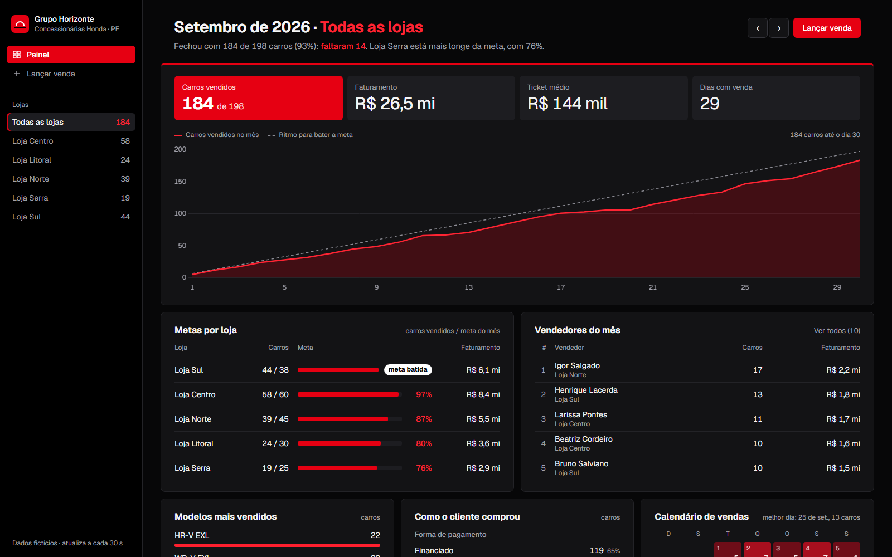
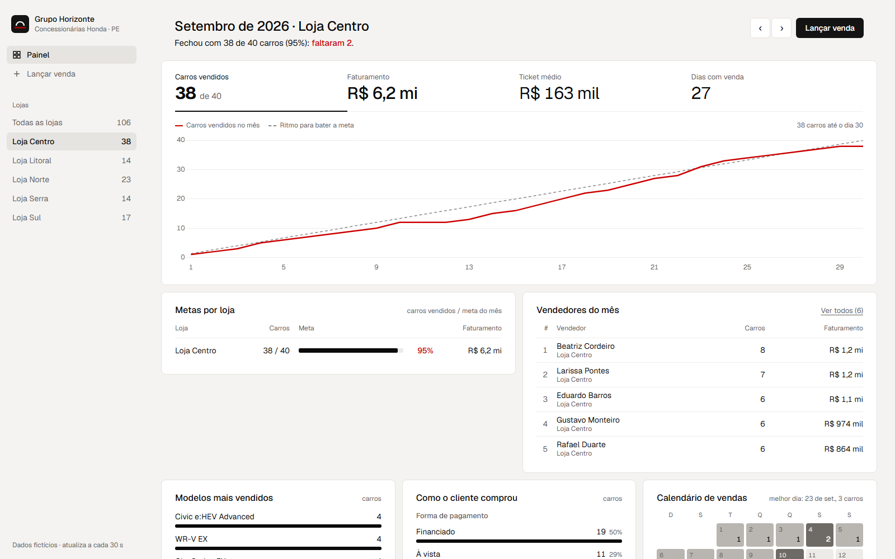
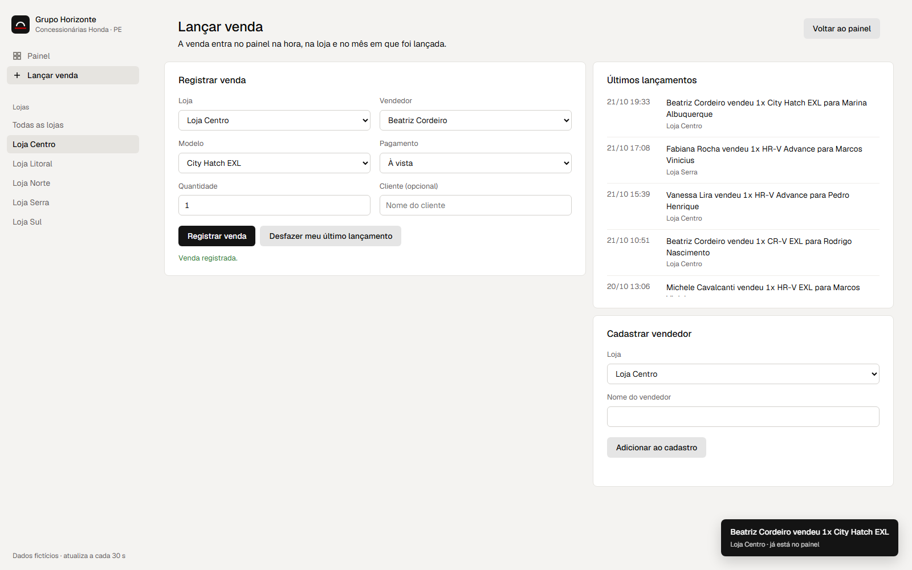

# Sales Dashboard — Horizonte Honda Group (fictional data)

[](https://github.com/DiegoSantiago1/analise-vendas-concessionaria/actions/workflows/ci.yml)

An analytics dashboard for a fictional network of Honda car dealerships: monthly targets per store, salesperson ranking, model mix, payment method and a daily sales calendar, with sales recorded in real time.

## 🔗 Access the project

[](https://diegosantiago1.github.io/Portifolio/projetos/painel-vendas/)
[](https://diegosantiago1.github.io/Portifolio/#projetos)

**Direct link:** https://diegosantiago1.github.io/Portifolio/projetos/painel-vendas/

The demo runs in the browser on the fictional data, with nothing to install. The full back end (PostgreSQL and the API) runs locally: see [Run it locally](#run-it-locally) and [Online demo](#online-demo).

[Português](README.pt-BR.md)



## Context

This project started from a real system I built at work, at a Honda dealership: a spreadsheet with Google Apps Script that the team used to follow the day's sales and the month's target. It is **in use at Honda dealerships in Recife**. It did the job, but had limits worth solving as a study project, and I could not publish the original: it holds real employee names and confidential sales targets.

So I rebuilt the problem from scratch: the same business need (follow sales, targets and performance per store and per salesperson), a new architecture, the technologies I use in my data career, and **100% fictional data**. No real company information is in this repository (see [Fictional data, on purpose](#fictional-data-on-purpose)).

## The problem the dashboard solves

A network with several stores needs to answer, every day:

- How much did we sell today, this week, this month, in total and per store?
- Is each store hitting its monthly target?
- Who are the top salespeople, and in which store?
- Which model and which category (sedan, hatchback, SUV) sell most?
- Financing, cash or consortium: what are customers choosing?
- Were there weak or strong days this month? Which was the best day?

The original system answered this on a single screen, but with no queryable history (only "today" and "this week"), no filter for a single store, and the target calculation running inside Apps Script, with no real database behind it.

## What changed from the original system

| | Original (Apps Script) | This project |
|---|---|---|
| Storage | Google Sheets | PostgreSQL, normalized tables |
| Back end | Google Apps Script (`doGet`/`doPost`) | REST API in Node.js + TypeScript + Express |
| Analytics | Computed in JavaScript, in the sheet | Aggregated in SQL (`SUM`/`GROUP BY`/views), in the database |
| Sale's manager | Picked by hand, could disagree with the salesperson | Derived from the salesperson (`vendedores.gerente_id`) |
| Store filter | Did not exist | Each store has the same KPIs, charts and calendar on its own |
| History | Only today and the current week | Any month, browsable |
| Time zone | Implicit | `TIMESTAMPTZ` + `ALTER DATABASE ... SET timezone` (see [Technical decisions](#technical-decisions)) |
| Running it | Tied to a Google account and sheet | `docker compose up` + `npm run dev`, on any machine |

## Architecture

```
Python (generates fictional data)
        │
        ▼
PostgreSQL 16 (Docker)  ──►  REST API (Node.js + TypeScript + Express)  ──►  Front end (HTML/CSS/JS + Chart.js)
   tables + views               aggregations in SQL, no ORM                   talks only to the API, no UI library
```

- **Database:** PostgreSQL 16 in a Docker container; the schema (`db/schema.sql`) is applied on first start through `docker-entrypoint-initdb.d`.
- **Data generation:** a Python script (`scripts/gerar_dados_ficticios.py`) fills the database with stores, sales staff, the model catalog and about 60 days of fictional but plausible sales (more on weekdays and near month end).
- **API:** Node.js + TypeScript + Express 5, with hand-written SQL through `pg` (no ORM, on purpose; see below). It also serves the front end, so development is a single process (`npm run dev`).
- **Front end:** plain HTML/CSS/JavaScript calling the API with `fetch`, and Chart.js for the charts. No framework: the screen did not justify React or Vue, and leaving it out kept the focus on back end, SQL and data modeling.

## Data model

```
lojas ──┬── gerentes ──┬── vendedores ──── vendas ──── modelos
        │              │
        └──────────────┴── (a store has 1+ managers and 1+ salespeople)
```

Table names are in Portuguese: `lojas` (stores), `gerentes` (managers), `vendedores` (salespeople), `vendas` (sales), `modelos` (car models).

- Normalized tables with foreign keys and `CHECK` constraints (e.g. `quantidade > 0`, `forma_pagamento IN (...)`).
- `vendas.valor_unitario` copies the model's price **at the time of the sale**, so history does not change when a price is updated later, as in a real sales system.
- **Integrity enforced by the database**, not only by the API: composite foreign keys reject a sale whose salesperson (or manager) belongs to another store, and a unique index rejects two salespeople with the same name in one store. Inserting straight into the database, bypassing the API, is blocked too.
- Two views (`vw_vendas`, `vw_metas_mes_atual`) join the tables once. The API uses `vw_vendas` for the latest-sales feed; both are ready for a BI tool such as Power BI to connect directly, without rewriting the joins.
- Indexes on `criado_em`, `(loja_id, criado_em)` and `vendedor_id`, the columns the dashboard filters and groups by most.

Full schema: [`db/schema.sql`](db/schema.sql).

## Technical decisions

**No ORM.** The API uses `pg` with hand-written SQL instead of Prisma or TypeORM. A deliberate learning choice: the goal was to practise real SQL (`JOIN`, `GROUP BY`, `date_trunc`, views, subqueries with `COALESCE`/`NULLIF`), not to hide it behind an ORM.

**Database time zone.** PostgreSQL runs in UTC inside the container by default. Without fixing that, a sale recorded at 9 pm in Recife would fall after midnight UTC, and every per-day report ("today's sales", the calendar) would put it on the next day. The fix is one line in the schema: `ALTER DATABASE vendas_honda SET timezone TO 'America/Recife'`. I found the bug testing by hand (an evening sale showed up on the wrong day in the calendar) and fixed it at the source, in the database, not by patching the front end.

**Manager derived from the salesperson, not picked by hand.** In the original system you could pick a salesperson from one store and a manager from another by mistake, because they were two independent fields. Here `vendedores.gerente_id` already ties each salesperson to the right manager, and the API derives the manager from the chosen salesperson. That removes a whole class of data-entry errors, and one field from the form.

**Aggregation in the database, not in the browser.** Every dashboard metric (KPIs, ranking, daily series, category mix) is a `SUM`/`GROUP BY` in SQL, behind `/api/analytics`. No aggregation runs in client-side JavaScript. Sending every sale over the network for the browser to add up does not scale; PostgreSQL does it orders of magnitude faster, and the API answer is ready to draw.

**A "bootstrap" endpoint.** `GET /api/bootstrap` returns the master data and the latest sales (stores, salespeople, models, feed) in one call, instead of the screen firing a cascade of requests each time it opens. I kept this idea from the original because it solved a real perceived-latency problem. The dashboard numbers come from `/api/analytics`.

**Month filter as a range, not `date_trunc` on the column.** `WHERE criado_em >= month_start AND criado_em < next_month_start` lets PostgreSQL use the index on `criado_em`; `date_trunc('month', criado_em) = ...` applies a function to the column and forces a full table read. Measured on a test database with 1 million rows: 314 ms with `date_trunc` against 29 ms with the range. With this project's ~190 rows the difference does not show, but it is the kind of detail that decides whether a query scales.

**Validation and errors.** Every input is validated at the edge: a body that is not JSON, wrong types, ids outside the `INT` range and names that are too long get a 400 (never a 500), and a duplicate salesperson gets a 409. The database stays the last barrier, so integrity does not depend on the API being right. `/api/health` queries the database (503 if it is down), and the connection pool handles the `error` event, so the API survives a PostgreSQL restart and recovers on its own.

**XSS.** Customer, salesperson, store and model names are escaped before going into HTML. I found the problem testing: an `` typed in the "Customer" field ran as code on the dashboard of anyone who opened it. I checked the fix with an automated browser (Playwright), against the real API and the demo: the name shows as text and no `` gets into the page.

**"Undo" only removes what you recorded.** The first version removed "the last sale in the database", which with two users could be someone else's. Now the dashboard keeps the id of the sale recorded in its own session and the API deletes by id (`DELETE /api/vendas/:id`). There is no authentication (it is a portfolio prototype), so this prevents the accident, not someone calling the API on purpose.

**Database port bound to `127.0.0.1` only.** Otherwise Docker would publish PostgreSQL on every network interface, reachable by anyone on the same Wi-Fi with the default development password.

**`minmax(0, 1fr)` in the CSS grids.** A real bug found with an automated browser (Playwright): after several rounds of switching store or month, with Chart.js recreating a chart on the same `<canvas>`, a 1366 px screen (a common laptop size) started scrolling sideways. Cause: a CSS Grid track defined as `1fr` never shrinks below its content's minimum width, and a canvas has a fixed pixel width. The fix (`minmax(0, 1fr)` on the dashboard's three grids) is the standard one for this classic CSS Grid problem.

## Fictional data, on purpose

All sales history comes from [`scripts/gerar_dados_ficticios.py`](scripts/gerar_dados_ficticios.py): 5 stores, 5 managers, 18 salespeople, 17 Honda models (public names, illustrative prices) and about 60 days of sales with plausible seasonality. Names of people, cities and targets are made up; no real data from the dealership where I work is in this repository. `random.seed(42)` fixes the draw, and the history is built backwards from an anchor date: with no argument the anchor is the day the script runs (so the dashboard always has sales "today"), and with `--ate YYYY-MM-DD` the same date always produces exactly the same data (checked by hashing the rows). The script is idempotent (`TRUNCATE ... RESTART IDENTITY CASCADE`). To be honest about it: the draw is uniform (every model and every salesperson in a store has the same chance), so the data serves the dashboard but does not hide patterns to "discover" in an analysis.

## Run it locally

Requirements: Docker Desktop, Node.js 24+, Python 3.13+.

```bash
# 1. Database (PostgreSQL in a container, schema applied automatically)
docker compose up -d

# 2. Environment variables
cp .env.example .env

# 3. Generate the fictional data
python -m venv .venv
.venv/Scripts/activate            # Linux/Mac: source .venv/bin/activate
pip install -r requirements.txt
python scripts/gerar_dados_ficticios.py            # or --ate 2026-09-23 for identical data every time

# 4. API + front end (one process, with hot reload)
cd server
npm install
npm run dev
```

Open **http://127.0.0.1:3333** (the server only accepts connections from this machine; use `PORT` and `HOST` to change that).

**Tests** (with the database up and the data loaded): `cd server && npm test`. 38 integration tests with Node's built-in runner: route validation, the record/undo cycle, analytics parameters, the ranking tie-break by revenue, the database integrity rules and the security headers. They leave nothing behind. **CI** runs the type check and the same tests on every push, against a real PostgreSQL 16 with the same schema and generated data (`.github/workflows/ci.yml`).

**Created the database before the integrity rules?** `schema.sql` only runs on an empty volume. Apply the migration: `docker exec -i honda-vendas-db psql -U honda -d vendas_honda -v ON_ERROR_STOP=1 < db/migracoes/001_integridade_e_indices.sql` (it runs in a transaction: all or nothing).

## Online demo

GitHub Pages only serves static files, so the demo uses neither Node nor PostgreSQL. The same front end (`web/`) runs with a layer that answers the `/api/` calls inside the browser, on the fictional data exported from the database.

```bash
python scripts/exportar_demo.py   # database -> demo/demo-data.json
node scripts/build_demo.mjs       # builds demo/dist: front end + API layer
```

- `demo/demo-api.js` reimplements in JavaScript the queries that are SQL in the real version (`SUM`/`GROUP BY`). I compared its answers with the real API's (8 queries per month and per store, the master data and the latest sales) and they are identical.
- The history is re-anchored on the day the page opens, so "today" always has sales.
- The demo opens on the last closed month (early in the current month there are few sales, which does not show the dashboard well). A sale you record goes to the current month. The server version opens on the current month, which is what the team follows day to day.
- Sales recorded in the demo live only in the page's memory: reloading resets it.

## Features

- **Pace to target:** the largest block on the screen shows the cars sold in the month, added up day by day, against the pace needed to hit the target. The line under the title says how many are missing and which store is furthest from its target. A tab switches the series to revenue.
- **Network-wide and per-store dashboard:** clicking a store in the sidebar filters KPIs, charts, calendar and ranking to that store.
- **Month navigation:** arrows at the top go through the history; you cannot go past the current month.
- **Sales calendar:** shade proportional to the day's volume, with the month's best day and today highlighted.
- **Recording a sale:** a form that validates store, salesperson and model, with a notice showing who sold which car. "Undo" removes only the sale recorded in your session.
- **Quick salesperson registration** in an existing store.
- Automatic refresh every 30 seconds.




## Technologies

`PostgreSQL 16` · `Docker` · `Python` (`SQLAlchemy`, `psycopg`) · `Node.js` · `TypeScript` · `Express 5` · `node:test` · `GitHub Actions` · `Chart.js` · `HTML/CSS/JavaScript`

## Possible next steps

- An analysis layer over a longer history with its own patterns (SQL with CTEs and window functions, a pandas notebook).
- Monthly report export to PDF or Excel.
- Authentication, if the dashboard ever moves from a portfolio prototype to real multi-user use.

---

A study project, part of my move from administration and logistics into data. More on [my GitHub](https://github.com/DiegoSantiago1) and [portfolio](https://diegosantiago1.github.io/Portifolio/).
